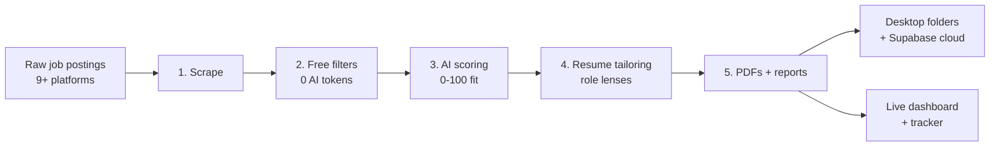
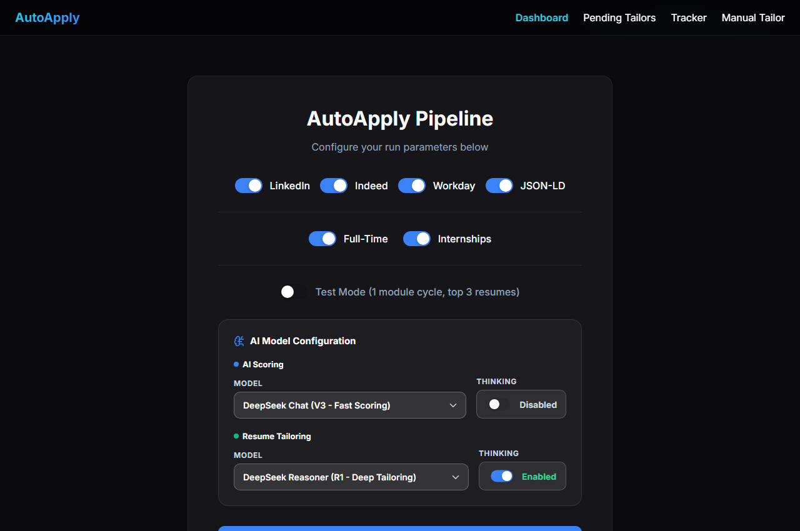
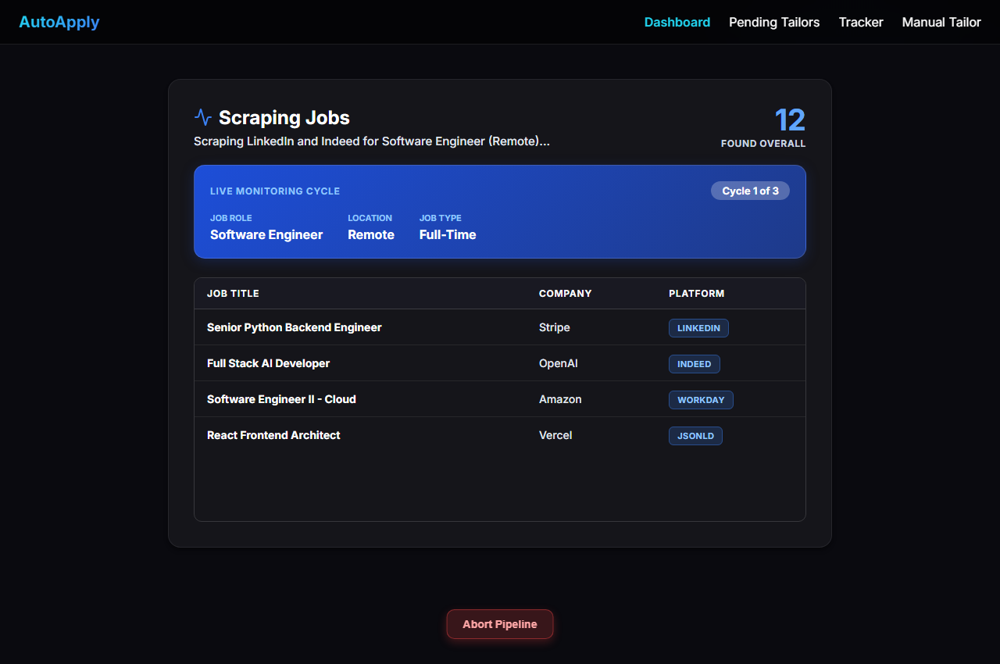
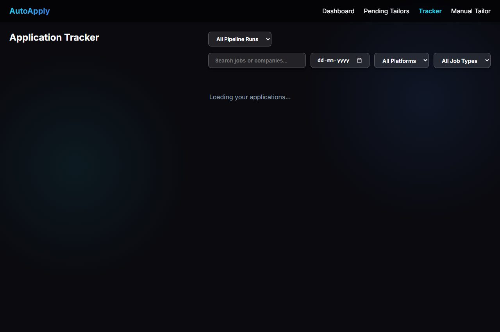
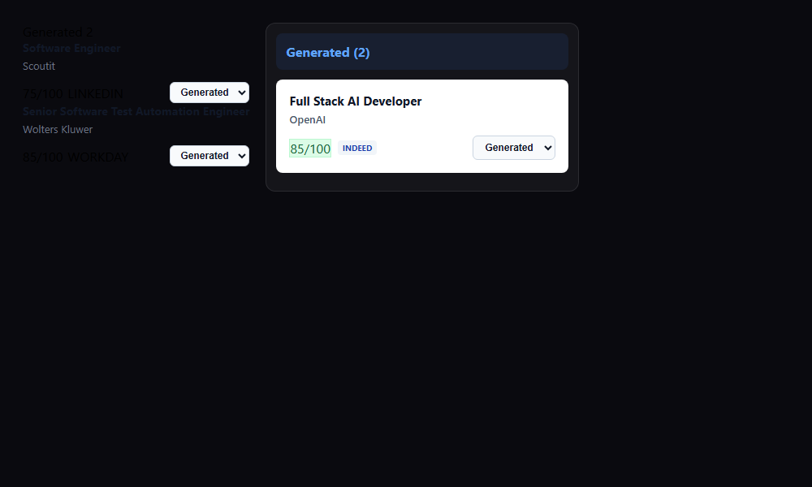
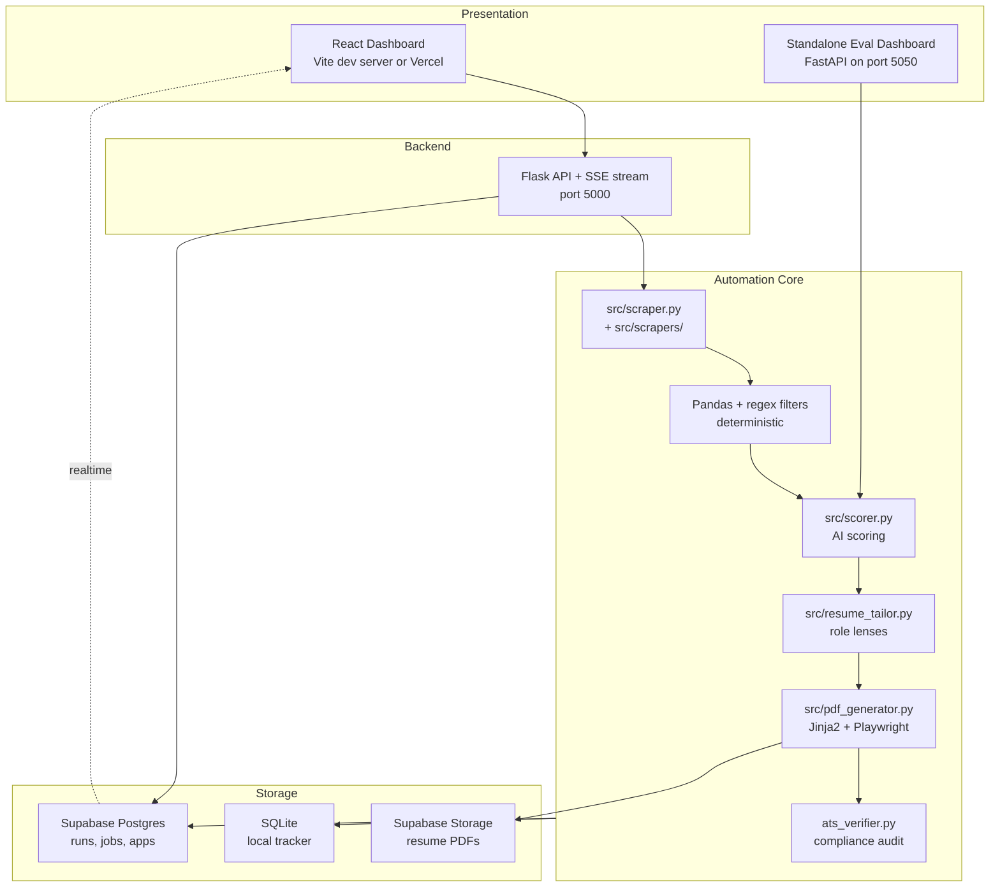
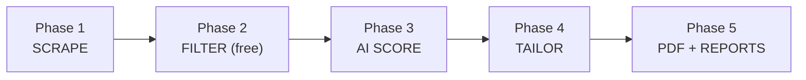
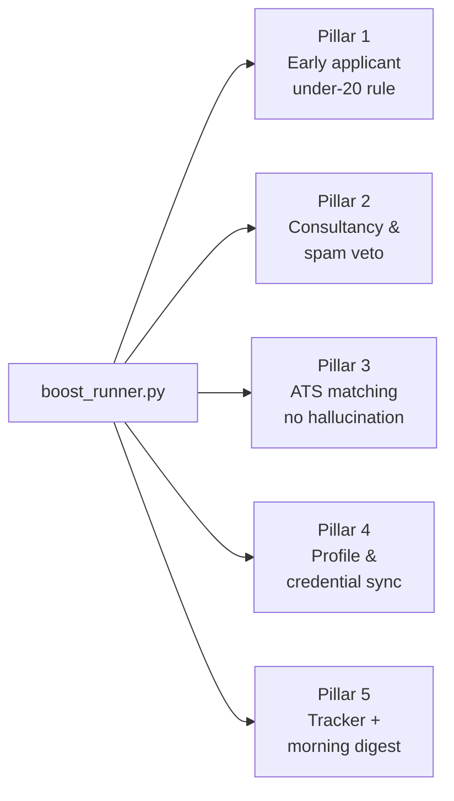
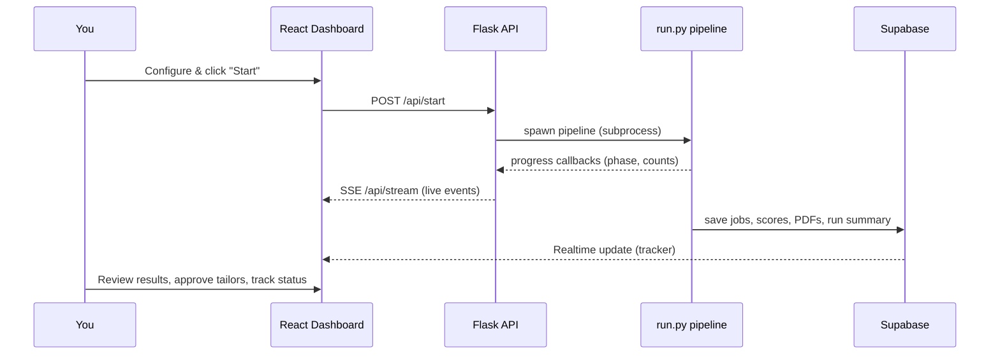
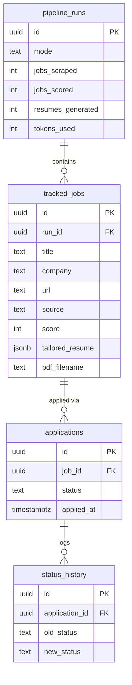

<div align="center">

# JobHunt Automation · "AutoApply"

**Your job hunt on autopilot.**<br/>
Scrape 9+ job platforms → throw away the noise for free → score every job against your resume with DeepSeek AI → auto-generate a tailored, ATS-safe 1-page resume for every match → track every application from a live dashboard.

<br/>

[](https://github.com/kaustubh12022/JobHunt-Automation/actions/workflows/ci.yml)


</div>

---

## 🤔 What Is This?

Applying for jobs as a fresher means doing the same five boring jobs, every single day:

| # | The boring job | What AutoApply does instead |
|---|---|---|
| 1 | Searching 9+ job sites for new postings | **Scrapes them all** automatically (LinkedIn, Indeed, Workday, Naukri, Internshala, Unstop, Hirist, Foundit + more) |
| 2 | Reading dozens of junk listings (consultancies, fee traps, senior roles, wrong tech stack) | **Filters them out for free** with Pandas + regex rules before any AI is used |
| 3 | Deciding "is this job actually a good fit for me?" | **Scores every job 0 – 100** against your master resume using DeepSeek AI |
| 4 | Rewriting your resume for each job (and keeping it on one page) | **Tailors a fresh resume per job** using role "lenses" — with a strict no-hallucination guardrail |
| 5 | Formatting PDFs and tracking what you applied to | **Generates ATS-safe PDFs** and keeps a live **tracker + dashboard** |

> 🍳 **Simple analogy:** think of AutoApply as a smart factory assembly line.
> Raw job postings go in one end. Out the other end come neatly organised, perfectly tailored resumes + a daily report telling you exactly where to apply. You stay the decision-maker — the robot does the boring parts.



### 🔰 New here? Read these 4 lines first

- **Entry point for a normal run:** `python run.py` (CLI) or the React dashboard (web UI).
- **Everything is guided by one config file:** `config.yaml`, and one profile: your resume (`data_folder/plain_text_resume.yaml`).
- **The AI is used only where it earns its keep:** scoring + resume wording. Filtering and dedupe are 100% deterministic and free.
- **All results land on your Desktop** (resume PDFs, summary reports) **and in Supabase** (cloud DB + file storage for the dashboard).

---

## 🗂️ Table of Contents

- [What Is This](#-what-is-this)
- [Screenshots](#-screenshots)
- [Architecture](#-architecture)
- [The Pipeline Phase by Phase](#-the-pipeline-phase-by-phase)
- [Component Encyclopedia](#-component-encyclopedia)
- [The Boost System](#-the-boost-system)
- [The Web Dashboard](#-the-web-dashboard)
- [API Reference](#-api-reference)
- [Databases](#-databases)
- [Guardrails](#-guardrails)
- [Cost Engineering](#-cost-engineering)
- [Getting Started](#-getting-started)
- [Configuration](#-configuration)
- [Testing](#-testing)
- [Project Structure](#-project-structure)
- [FAQ](#-faq)
- [Documentation Map](#-documentation-map)
- [Credits](#-credits)

---

## 🖼️ Screenshots

| Dashboard — configure a run | Live pipeline — watching it scrape |
|---|---|
|  |  |

| Application tracker — filters & Kanban | Job cards — score + platform badges |
|---|---|
|  |  |

Also in `test_screenshots/`: pipeline snapshot (`3_persistent_snapshot_verified.png`), mobile tracker (`5_tracker_mobile_verified.png`) and a Kanban column close-up (`7_kanban_column_verified.png`).

---

## 🏗️ Architecture

At the highest level there are **two user interfaces**, **one automation core**, and **three places data lives**.



**Tech stack at a glance**

| Layer | Technology | Role |
|---|---|---|
| Scraping | `python-jobspy` + 8 custom scrapers | LinkedIn/Indeed via JobSpy; Workday, Naukri, Instahyre, Internshala, Unstop, Hirist, Foundit, generic JSON-LD sites via custom code |
| Filtering | Pandas + regex rules | Zero-cost pruning: seniors, wrong stacks, spam, duplicates |
| AI | DeepSeek (`deepseek-chat`, optional `deepseek-reasoner`) via the OpenAI SDK | Job scoring + resume tailoring, with token/cost telemetry |
| PDFs | Jinja2 HTML template → Playwright Chromium → A4 PDF; ReportLab for reports | 1-page ATS resumes, table PDFs, summary reports |
| Backend | Flask + Server-Sent Events (SSE) | Runs the pipeline, streams live progress, serves the SPA |
| Frontend | React 19 + Vite (plain CSS) | Dashboard, live view, tailors, tracker, manual tailor |
| Cloud | Supabase (Postgres + Storage + Realtime) | Shared state for the dashboard, PDF hosting, caching |
| Local | SQLite + Desktop folders | Offline tracker + every deliverable saved on your machine |

---

## ⚙️ The Pipeline Phase by Phase

The heart of the project is a single command — `python run.py` — that executes **5 phases** and prints live progress to the console **and** to the web dashboard.



> 💡 Before Phase 1, `run.py` waits for the **15:31 IST "off-peak" window** so DeepSeek calls get the **50% discount** — unless you pass `--no-wait-offpeak`.

### Phase 1 — Scraping 🔍

*"Go look everywhere a job could be posted — right now."*

| Platform | How it is scraped | Notes |
|---|---|---|
| LinkedIn | `python-jobspy` | Full-time roles (internships excluded — JobSpy limitation) |
| Indeed | `python-jobspy` | India (`country_indeed: India`) |
| Workday | Custom scraper (`src/scrapers/workday.py`) | Corporate careers sites driven by `src/scrapers/employers.yaml` |
| Naukri | Custom scraper (`src/scrapers/naukri.py`) | Fetches via a Jina AI reader bridge to get clean text |
| Instahyre | Custom scraper | Startup-focused hiring platform |
| Internshala | Custom scraper | Internships & fresher roles |
| Unstop | Custom scraper | Events/internships for freshers |
| Hirist | Custom scraper | Tech-only job board |
| Foundit | Custom scraper | Ex-Monster India |
| Any JSON-LD site | Generic scraper (`src/scrapers/jsonld.py`) | Reads `schema.org/JobPosting` data from `jsonld_sites.yaml` list |

**Key behaviour**
- `hours_old: 48` → only jobs posted in the last 2 days (fresh jobs = real openings).
- Searches run across **4 role buckets** (`full_stack`, `java_backend`, `enterprise_trainee`, `ai_genai`) × 3 locations (Pune, Mumbai, Bangalore) × 12 search terms.
- URLs are normalised (tracking parameters stripped) so the same job from 2 sources doesn't count twice.
- Scraping happens with **callback hooks** — that's how the dashboard shows "Scraping Jobs… 12 found" live.

### Phase 2 — Free Pre-Filters 🧹 (0 AI tokens)

*"Throw out everything that clearly isn't worth an AI call."*

Two deterministic layers run before the AI ever gets involved:

1. **Pandas layer** (`apply_pandas_filter`): drops broken/duplicate rows, empty descriptions, obvious non-matches, and applies location aliasing (e.g. "Bengaluru" = "Bangalore").
2. **Regex layer** (`src/scorer.py` helpers + rules): removes boilerplate text, then checks:
   - **Seniority** — "Senior/Lead/Principal/Manager" titles and "3+ years required" patterns are dropped (`matches_senior_title`, `requires_3_plus_years`).
   - **Out-of-scope stacks** — roles demanding stacks outside the verified skill inventory are dropped.
   - **Domain anchors** — a JD must mention real tech/domain anchors to pass relevance (`is_relevant_jd`).

> 💰 This is the single biggest cost saver: **most junk is removed before a single AI token is spent.**
> Want a completely free run? `--zero-ai` replays the whole pipeline deterministically at **$0**.

### Phase 3 — AI Scoring 🧠

*"For every remaining job, ask: how good a fit is this for ME, 0 – 100?"*

- **Engine:** `src/scorer.py` → `src/ai_engine.py` → DeepSeek via the OpenAI SDK.
- **Prompt:** stored in `src/prompts/scoring_prompt.txt` — the model returns strict JSON: `fit_score` (0–100), `missing_skills`, `extracted_requirements`, `reasons`, `is_testing_role`.
- **Concurrency:** jobs are scored in parallel with retry/backoff on rate limits (`429`/`503`), plus **prompt-cache warming** to reuse shared context (the candidate profile) across calls.
- **Threshold:** jobs scoring **≥ `minimum_score` (default `75` in `config.yaml`, CLI default `60`)** are shortlisted for tailoring. The top-N limiter (`top_n: 30`) protects your budget.
- **`jd_cache`:** every scored JD is cached in Supabase by URL — re-runs never pay twice for the same job.
- **Telemetry:** `TokenUsage` in `src/ai_engine.py` tracks tokens + USD cost per run, saved to `pipeline_runs.tokens_used`.

### Phase 4 — Resume Tailoring ✂️

*"Rewrite my resume so it clearly matches this job — without inventing anything."*

- **Role lenses:** `src/resume_tailor.py` keeps four pre-designed "lenses" for your resume — `qa`, `java`, `dotnet`, `fullstack` — and picks the best lens per job.
- **Master data only:** the model may only use your master projects and skills (`CANONICAL_MASTER_PROJECTS`, `MASTER_SKILL_ALIASES`). The resume budget is fixed: **3 projects, 3+2+2 bullets** — everything must fit **one A4 page**.
- **No-hallucination guardrail:** `validate_and_sanitize_tailored()` re-checks the model's JSON against your master profile and strips anything unrecognised before it can reach a PDF.
- **Delta-merge:** re-tailoring for a similar job only regenerates what changed, saving tokens.

### Phase 5 — PDF Generation & Reports 📄

*"Turn the tailored JSON into a clean, machine-readable PDF — and package the whole day's work."*

- **Resume PDFs:** Jinja2 template (`templates/resume_template.html`) → rendered by **Playwright Chromium** → A4 PDF, strictly **1 page**. Fonts/kerning are chosen so ATS text extraction never splits words like "T echnical".
- **ATS audit:** `ats_verifier.py` runs 11 checks on every PDF (see [Guardrails](#-guardrails)).
- **Report documents:**
  - `Job_Applications_Table.pdf` — sorted table: Company | Role | **Direct Apply Link** (clickable).
  - `Resume_Created_Jobs.pdf` — visual catalog grouped by platform, split into **⚡ Easy Apply** vs **🌐 Company Site** sections, with resume links.
  - `Summary.pdf` — KPI cards (links analysed, resumes generated, average ATS score), shortlist table, low-relevance list, failed-link cards, strategic notes (built with ReportLab).
  - `Summary.md` — the same story in Markdown.
- **Upload:** every resume PDF is uploaded to the Supabase **`resumes`** storage bucket and gets a public link used by the catalog/tracker.
- **Archive:** `src/archive_packager.py` builds `Desktop/8 October 2026.zip` — one folder per platform containing its table PDF + all resume PDFs, with a parity audit (job count vs resume count) before shipping.

---

## 🧩 Component Encyclopedia

Every file in the repo, one line each. (Skip this section on a first read — come back when you need to find *where something lives*.)

### Entry points (what you actually run)

| File | What it is | When to use it |
|---|---|---|
| `run.py` | **Main pipeline CLI.** 5 phases, off-peak DeepSeek wait, callbacks for the dashboard. Flags: `--test-mode`, `--dry-run`, `--no-wait-offpeak`, `--target-time 15:31`, `--no-tailor`, `--no-table-pdf`, `--hours-old`, `--platforms`, `--strict-3-col`, `--zero-ai`, `--no-docs` | The normal daily sweep |
| `app.py` | **Flask backend + dashboard API.** Runs pipelines as subprocesses, streams progress via SSE, serves the React SPA, exposes review/tailor endpoints | Web UI backend (port 5000) |
| `boost_runner.py` | **5-Pillar Boost System orchestrator** (see below). Flags: `--sync-profile`, `--poll`, `--veto-audit`, `--digest`, `--full`, `--test` | The "do everything extra" run |
| `hunter_runner.py` | **Autonomous overnight hunter.** Keeps the PC awake, waits for Wi-Fi, runs the portal sweep (`run.py`) + batch URL tailoring (`run_batch_urls.py`), then builds the daily ZIP archive. Logs to `hunter_pipeline.log` | Scheduled unattended runs |
| `morning_runner.py` | **10:00 AM IST assistant.** Syncs your profile → runs `run.py --no-wait-offpeak` → packages the archive → writes your morning digest. Logs to `morning_pipeline.log` | Windows Task Scheduler entry point |
| `run_batch_urls.py` | **Batch URL CLI.** Paste raw text (e.g. a WhatsApp/Telegram message full of job links) → parses, scores, tailors. Writes `batch_summary_report.json` | Applying to links friends send you |
| `run_dashboard.py` | **Standalone evaluation dashboard** (FastAPI, port 5050). Independent scoring bench: Gemini + Groq, live logs, CSV/JSON export | Auditing scoring quality offline |

### The core package (`src/`)

| Module | One-line summary |
|---|---|
| `src/scraper.py` | The scraper engine: JobSpy (LinkedIn/Indeed) + all custom scrapers, Pandas pre-filter, URL normalisation, location aliases, freshness windows |
| `src/scrapers/` | One dedicated scraper per platform (`workday.py`, `naukri.py`, `instahyre.py`, `internshala.py`, `unstop.py`, `hirist.py`, `foundit.py`, `jsonld.py`) + config lists (`employers.yaml`, `jsonld_sites.yaml`) |
| `src/scorer.py` | The scoring brain: boilerplate stripping, free regex filters, concurrency, prompt-cache warming, `jd_cache`, zero-AI deterministic mode |
| `src/ai_engine.py` | DeepSeek client + pricing table + `TokenUsage` telemetry + retries |
| `src/resume_tailor.py` | Role lenses, master skills/projects constants, no-hallucination sanitiser, delta-merge tailoring |
| `src/pdf_generator.py` | Jinja2 + Playwright PDF rendering, ATS audit hooks, optional 3-column table PDF |
| `src/batch_url_pipeline.py` | The batch engine behind `run_batch_urls.py`: extracts URLs from messy text, parses JDs via a 4-tier strategy (SmartRecruiters API → requests → Playwright → synthetic), scores, tailors, builds reports |
| `src/models.py` | Shared data classes (e.g. `Job`) used across every phase |
| `src/config_loader.py` | Loads `config.yaml`, provides helper utilities (e.g. human date strings) |
| `src/logger.py` | Project-wide logger (loguru) writing consistent console + file logs |
| `src/db.py` | Supabase client + persistence (`pipeline_runs`, `tracked_jobs`, `applications`, `jd_cache`), PDF path resolution |
| `src/prompts/` | `scoring_prompt.txt`, `tailoring_prompt.txt` — the exact prompts (kept out of code so they're editable) |
| `src/tracker.py` | Local SQLite application tracker (statuses, submission audits, daily metrics) — Pillar 5 |
| `src/early_applicant.py` | Pillar 1: the "<20 applicants" early-detection rule + `FastPollingEngine` for continuous fresh-job polls |
| `src/consultancy_veto.py` | Pillar 2: fee-trap / consultancy / non-tech / repost vetoes + URL & fingerprint dedupe |
| `src/profile_manager.py` | Pillar 4: builds `config/profile.json` from your Desktop resume, validates ATS invariants, stores EEO answers |
| `src/morning_digest.py` | Pillar 5: writes `Morning_Digest_<date>.md` (+ JSON telemetry) into a dated Desktop folder |
| `src/archive_packager.py` | Builds the per-platform daily ZIP with tables + resumes, merges previous runs, mirrors to OneDrive, cleans Desktop |
| `src/summary_pdf.py` | `Summary.pdf` — KPI cards + shortlist/low-score/failed tables (ReportLab) |
| `src/visual_catalog_pdf.py` | `Resume_Created_Jobs.pdf` — visual catalog grouped by platform & apply type |
| `src/bots/naukri_bot.py` | Standalone auto-apply bot for Naukri: drives the site with Selenium using your saved credentials, optionally using Gemini to answer screening questions |
| `src/agent_prompt.md` | House rules doc for AI agents that contribute to this repo |

### Frontend (`frontend/`)

| Piece | What it does |
|---|---|
| `src/App.jsx` | Router + shell: Dashboard, Live Pipeline, Pending Tailors, Tracker, Job Detail, Manual Tailor |
| `src/pages/Dashboard.jsx` | Run configuration: platform toggles, full-time/internship toggles, test mode, AI model pickers (DeepSeek Chat V3 for fast scoring / DeepSeek Reasoner R1 for deep tailoring, "thinking" toggle) |
| `src/pages/LivePipeline.jsx` | Real-time scan view driven by the SSE stream — jobs appear as they're found |
| `src/pages/PendingTailors.jsx` | Review queue: score a job manually, generate one resume or a batch |
| `src/pages/Tracker.jsx` | Application tracker with filters and a **Kanban board** (e.g. Generated column) + `MobileTrackerView` |
| `src/pages/JobDetailPage.jsx` | Everything about one job: description, score, resume actions |
| `src/pages/ManualTailor.jsx` | Paste any JD text → score it → generate a tailored resume on the spot |
| `src/components/tracker/*` | `KanbanBoard.jsx`, `ApplicationCard.jsx`, `FilterBar.jsx`, `MobileTrackerView.jsx` |
| `src/lib/api.js` | API base URL helper (`VITE_API_BASE`, dev proxy `/api` → `localhost:5000`) |
| `src/lib/supabase.js` | Supabase JS client for realtime tracker updates |
| `vercel.json` | SPA rewrite for Vercel deploys |

### Standalone dashboard (`standalone_dashboard/`)

| File | What it does |
|---|---|
| `server.py` | FastAPI app (:5050): dataset loading, run control, SSE (`/api/events`), CSV/JSON export, stats |
| `engine.py` | Dual-provider scoring engine: **Gemini** (`gemini-3.5-flash-lite`) + **Groq** (`qwen/qwen3.8-27b`), JSON recovery, retries |
| `rate_limiter.py` | Sliding-window rate limiter (Gemini ≤15 RPM, Groq ≤20 RPM) |
| `static/app.js` + `templates/index.html` | The bench UI: live terminal, tabs (All / Selected / Rejected), search, exports |

> Why it exists: before trusting the production scorer, this bench replays hundreds of JDs through **two different AI providers** and lets you compare verdicts side by side — your scoring quality is measured, not guessed.

### Helper scripts & setup

| File | What it does |
|---|---|
| `ats_verifier.py` | CLI that audits any resume PDF against 11 ATS parsing rules: `python ats_verifier.py resume.pdf` |
| `prepare_bundle.py` | Copies the latest run's resume PDFs into `Desktop/Job_Resumes/`, renders `Job_Summary.pdf`, zips everything |
| `generate_pdf_links.py` | Builds `Desktop/Job_Links.pdf` — a clickable list of the latest run's apply links |
| `get_data_summary.py` | Prints a read-only summary of recent Supabase runs and job counts |
| `setup_db.py` | Creates all Supabase tables + the `resumes` storage bucket (needs `DATABASE_URL`) |
| `setup_live_table.py` | Creates the `live_pipeline` singleton table and enables it for Supabase Realtime |
| `setup_supabase.sql` | Plain SQL version of the core schema (also disables RLS so the backend can write) |
| `install_deps.bat` | Installs everything: numpy, jobspy, core deps, Playwright Chromium, and verifies imports |
| `run_autoapply.bat` | One-click full local stack: Flask :5000 + Vite :5173 + opens the browser + prints your phone URL |
| `run_dashboard.bat` | One-click standalone evaluation dashboard (:5050) |
| `open_firewall_ports.bat` | Opens Windows firewall ports 5000/5173 so your phone can use the dashboard on the same Wi-Fi |

### Deployment

| File | Purpose |
|---|---|
| `Procfile` | Render deploy: `gunicorn app:app --workers 2 --timeout 120` |
| `vercel.json` | Routes `/api/*` → the Python app and everything else → the Vite build |
| `.github/workflows/ci.yml` | Python CI: `pip install -r requirements.txt` + `pytest` on every push/PR |
| `.github/workflows/stale.yml` | Auto-manages stale issues/PRs |

---

## ⚡ The Boost System

Beyond the standard pipeline, `boost_runner.py` implements a **5-pillar blueprint** distilled from job-hunt research — five extra engines that each attack one weakness of a normal application process.



| Pillar | Engine | What it actually does |
|---|---|---|
| 1. Be first | `src/early_applicant.py` | Detects "be one of the first N applicants" and low applicant counts. Jobs get a **priority tier + score boost**: `<10 applicants or ≤2h old` → **+25**, `<20 or ≤6h` → **+15**, saturated (>50 applicants) → **−10**. `FastPollingEngine` re-checks feeds every N seconds and fires a callback the moment a fresh gem appears |
| 2. Filter the fake-out | `src/consultancy_veto.py` | Vetoes **fee traps** ("registration fee", "security deposit", "100% placement guarantee…"), **third-party consultancies**, **non-tech roles** (BPO/telecalling/data entry) and **repost spam** — including adversarial text like `r e g i s t r a t i o n`. Dedupes by normalised URL *and* by a title+company fingerprint |
| 3. Stay compliant | `src/resume_tailor.py` + `src/pdf_generator.py` + `ats_verifier.py` | Tailors ATS-safe resumes and proves compliance with the 11-check audit before anything is submitted |
| 4. Perfect profile | `src/profile_manager.py` | Builds `config/profile.json` (mirrored to `Desktop/profile.json`) from your Desktop resume: contact block, education, projects, structured skills, target roles, and **EEO/form answers** (work authorisation, languages, address…) for auto-filling applications. Validates ATS invariants: 4-digit years only, exact phone format, ≥3 projects, ≥15 skills |
| 5. Track everything | `src/tracker.py` + `src/morning_digest.py` | SQLite tracker with statuses (`DISCOVERED → SHORTLISTED → TAILORED → APPLIED`, or `VETOED_SPAM`), **verified submission audits** (confirmation IDs, screenshots), and a **morning executive digest**: daily funnel numbers, top early opportunities, veto summary, submission receipts, suggested action plan — written to `Desktop/<date>/Morning_Digest_<date>.md` |

**CLI**

```bash
python boost_runner.py --sync-profile          # Pillar 4: rebuild profile.json from Desktop resume
python boost_runner.py --poll                  # Pillar 1: fast poll loop (default every 60s)
python boost_runner.py --veto-audit            # Pillar 2: audit the feed for spam/fee traps
python boost_runner.py --digest                # Pillar 5: write today's morning digest
python boost_runner.py --full                  # Everything: sync → scrape → veto → tailor top-5 → audit top-2 → digest
python boost_runner.py --test                  # Small-batch verification run
```

---

## 🖥️ The Web Dashboard

Two ways to run the web app:

```bash
# one click on Windows (starts backend + frontend + opens browser)
run_autoapply.bat

# or manually
python app.py                 # Flask API      -> http://localhost:5000
cd frontend && npm run dev    # React frontend -> http://localhost:5173
```

The React app talks to Flask; Flask spawns the pipeline; the pipeline reports progress **live over SSE**; Supabase Realtime keeps the tracker fresh in every open tab.



**What you can do in the UI**

- 🎛️ **Configure runs** — toggle platforms (LinkedIn, Indeed, Workday, JSON-LD…), full-time/internships, test mode, and pick AI models per task.
- 📡 **Watch live** — jobs stream in while scraping; phase indicator shows Scrape → Score → Tailor.
- 🧵 **Pending Tailors** — jobs shortlisted but not yet tailored; generate one or in batch.
- 🃏 **Tracker** — filter by run/platform/type/date, search, Kanban board, mobile view; deletes propagate to Supabase.
- ✍️ **Manual Tailor** — paste an external JD, score it, generate a tailored resume instantly.
- 👤 **Profile editor** — `GET/POST /edit_profile` + `templates/edit_profile.html`.

---

## 🔌 API Reference

All endpoints live in `app.py` (Flask, port 5000).

| Method | Endpoint | Purpose |
|---|---|---|
| GET | `/`, `/<path>` | Serve the React SPA (fallback route) |
| POST | `/api/start` | Start a full pipeline run with selected config |
| POST | `/api/test-start` | Start a quick test-mode run |
| POST | `/api/stop` | Gracefully stop the running pipeline |
| GET | `/api/status` | Current pipeline state snapshot |
| GET | `/api/stream` | **SSE** live event stream (phases, counts, logs) |
| GET | `/api/logs` | Recent log lines |
| POST | `/api/generate-resumes` | Generate resumes for selected shortlisted jobs |
| GET | `/api/pending-tailors` | Jobs awaiting tailoring |
| POST | `/api/manual-tailor/score` | Score a pasted JD |
| POST | `/api/manual-tailor/generate` | Tailor one pasted JD |
| POST | `/api/manual-tailor/generate-batch` | Tailor several pasted JDs |
| GET | `/api/resume/<job_id>` | Fetch a generated resume PDF |
| GET | `/api/resume/manual/<filename>` | Fetch a manually generated resume |
| GET/POST | `/api/ai-settings` | Read/update model choices |
| GET/POST | `/edit_profile` | Read/update the candidate profile |
| GET | `/api/config` | Current configuration |
| DELETE | `/api/runs/<run_id>` | Delete a pipeline run |
| DELETE | `/api/applications/<app_id>` | Delete an application record |

---

## 🗄️ Databases

### Supabase — the cloud brain (shared by dashboard + pipeline)



- **`pipeline_runs`** — one row per run: counts, platforms, scrape stats, token usage.
- **`tracked_jobs`** — every job that survived filtering, with score, missing skills, tailored JSON, PDF filename.
- **`applications` + `status_history`** — application lifecycle + full audit trail of status changes.
- **`jd_cache`** — scored JDs by URL, so no job is ever paid for twice.
- **`live_pipeline`** — a singleton row updated during runs; enabled for **Realtime** so the dashboard updates without polling.
- **Storage bucket `resumes`** — public PDFs with stable links used in catalogs and the tracker.

### SQLite — the local tracker (private, works offline)

`data_folder/application_tracker.db`, managed by `src/tracker.py`:

| Table | Contents |
|---|---|
| `tracked_jobs` | Job + status (`DISCOVERED`, `SHORTLISTED`, `VETOED_SPAM`, `TAILORED`, `APPLIED`), early-applicant tier, veto reason, tailored resume path |
| `submission_audits` | Receipts of applications: portal, timestamp, **confirmation ID**, screenshot path, verification flag |
| `daily_metrics` | Funnel counters per day (scanned → early → vetoed → shortlisted → tailored → applied) — the source of the morning digest |

---

## 🛡️ Guardrails

Automation that lies on your resume is worse than no automation. This project is unusually strict about it — here is every safety net:

| Guardrail | Where | What it prevents |
|---|---|---|
| No-hallucination sanitizer | `src/resume_tailor.py` → `validate_and_sanitize_tailored()` | The AI rewriting/wording with **any skill, project or number that isn't in your master profile** |
| Verified inventory | Master skills + `MASTER_SKILL_ALIASES` | Claims like "REST Assured" or "TestNG" can never appear unless they're truly in your inventory |
| ATS compliance audit | `ats_verifier.py` — 11 checks | 2-page resumes, 2-digit years (`'25`), kerning word-splits (`T echnical`), missing header location, collided text (`TechnologiesPune`), broken glyphs, non-`+91` phone, missing CGPA/10th/12th warnings |
| Consultancy & fee-trap veto | `src/consultancy_veto.py` | Being scammed by "registration fee" listings or recruiter spam |
| Dedupe (URL + fingerprint + description flood) | `src/consultancy_veto.py` | The same job counted 5× across platforms/boards |
| Seniority & scope filters | `src/scorer.py` | Wasted AI spend on roles you can't get (seniors, 3+ years, wrong stack) |
| Strict profile validation | `src/profile_manager.py` | Profile drift from your real resume (validates phone, location, years format, CGPA, project/skill counts) |
| Test mode + dry run | `run.py` flags | Accidentally burning budget on a full run before you trust the config |
| Verified submissions | `src/tracker.py` | "Applied but not really" — audits store confirmation IDs and screenshots |

---

## 💸 Cost Engineering

LLM calls are the only real expense, so the design squeezes them from every side:

| Trick | Saving |
|---|---|
| 15:31 IST off-peak window (`run.py` waits for it by default) | DeepSeek **50% discount** on every token |
| Deterministic pre-filters (Pandas + regex) | Most junk never reaches the AI at all |
| `jd_cache` (Supabase) | Never pay twice to score the same job |
| Prompt-cache warming | Shared context (your profile) is cached between calls |
| Delta-merge tailoring | Only changed resume sections are regenerated |
| `top_n` limiter + score threshold | AI only spends effort on the best candidates |
| `--zero-ai` mode | Full pipeline replay at **exactly $0** |
| Test mode | 1 search term, ~5 results, 3 scores, 1 resume — a cheap end-to-end rehearsal |
| Token telemetry | Every run records tokens + USD so there are no surprises |

---

## 🏁 Getting Started

### Prerequisites

- **Windows 10/11** (batch files + Task Scheduler flows assume Windows), Python **3.10+**, Node.js 18+ (for the frontend), a free **Supabase** project, and a **DeepSeek API key**.

### 1. Install

```bash
git clone https://github.com/kaustubh12022/JobHunt-Automation.git
cd JobHunt-Automation
install_deps.bat            # recommended on Windows
```

<details>
<summary>Manual install (any OS)</summary>

```bash
pip install -r requirements.txt
python -m playwright install chromium
```

</details>

### 2. Configure secrets (`.env`)

Create a `.env` in the project root. **Never commit it.**

| Variable | Used by | Purpose |
|---|---|---|
| `DEEPSEEK_API_KEY` | Scoring + tailoring | The main AI key |
| `SUPABASE_URL` | Backend + dashboard | Your Supabase project URL |
| `SUPABASE_KEY` | Backend + dashboard | Supabase anon key |
| `SUPABASE_SERVICE_ROLE_KEY` | Backend (writes) | Optional; takes priority over `SUPABASE_KEY` for server-side writes |
| `DATABASE_URL` | `setup_db.py`, `setup_live_table.py` | Direct Postgres connection string (schema setup only) |
| `NAUKRI_EMAIL` / `NAUKRI_PASSWORD` | `src/bots/naukri_bot.py` | Naukri auto-apply login |
| `GEMINI_API_KEY` | Naukri bot, standalone dashboard, audits | Secondary AI provider (form answers, evaluations) |
| `GROQ_API_KEY` | Standalone dashboard, audits | Second provider for cross-checking scores |
| `GEMINI_MODEL` | Naukri bot | Optional model override |

### 3. Create the cloud schema (one time)

```bash
python setup_db.py           # tables + storage bucket
python setup_live_table.py   # realtime pipeline table
```

### 4. Drop in your resume

Put your master resume as `data_folder/plain_text_resume.yaml` (see `data_folder_example/` for the format). If a `plain_text_resume.yaml` exists on your Desktop, the Boost profile sync can pull it from there too.

### 5. Run it

| I want to… | Command |
|---|---|
| Run the full sweep (CLI) | `python run.py` |
| Quick rehearsal, tiny budget | `python run.py --test-mode` |
| Completely free, no AI | `python run.py --zero-ai` |
| Everything extra (boost system) | `python boost_runner.py --full` |
| Score & tailor links from a chat message | `python run_batch_urls.py --raw-text` |
| Full local web app | `run_autoapply.bat` |
| Evaluation dashboard (Gemini/Groq bench) | `run_dashboard.bat` |

### 6. Where results land

| Location | Contents |
|---|---|
| `Desktop/AutoApply_Output/` | Main run outputs: resume PDFs + report PDFs |
| `Desktop/<D Month YYYY>.zip` | Archived deliverable: per-platform folders + tables + resumes |
| `Desktop/<date>/Morning_Digest_<date>.md` | The boost morning digest (+ `morning_digest.json`) |
| `Desktop/Tailored_Resumes_<date>/` | Batch-URL mode outputs + `Summary.pdf` / `Summary.md` |
| Supabase Storage (`resumes`) | Public resume PDF links used by the dashboard |

---

## 🔧 Configuration

Everything tunable lives in **`config.yaml`**:

| Section | Key settings |
|---|---|
| `ai` | `provider: deepseek`, `scoring_model` / `tailoring_model` (default `deepseek-chat`; the UI can switch tailoring to `deepseek-reasoner`), `temperature: 0.3` |
| `search` | Platforms, 12 search terms in 4 role buckets (`full_stack`, `java_backend`, `enterprise_trainee`, `ai_genai`), locations (Pune/Mumbai/Bangalore), `hours_old: 48`, `max_experience_years: 0` (fresher-only), `results_wanted: 500`, job types (`fulltime` + `internship`) |
| `scoring` | `minimum_score: 75` (CLI default is 60), `top_n: 30` |
| `test_mode` | 1 term/location/platform, 5 results, skip Workday, score 3, tailor 1 |
| `output` | `desktop_path` + `folder_name: AutoApply_Output` |
| `resume` | `style: ats_clean`, `max_pages: 1` |

> 💡 `src/profile_manager.py` keeps `config/profile.json` in sync with your resume — that JSON (skills, projects, EEO answers) is what the AI is allowed to use.

---

## 🧪 Testing

```bash
pytest                 # what CI runs on every push / PR (.github/workflows/ci.yml)
```

The suite in `tests/` is not a formality — it includes:

- **e2e tiers** — feature coverage, boundary/negative cases, pairwise combinations, workload scenarios (`tests/e2e/`).
- **Adversarial suites** — per-milestone "challenger" tests that try to break scoring, tailoring guardrails, PDF/ATS output, and Supabase UI sync.
- **A 200-job fixture dataset** (`tests/fixtures/jobs_200_dataset.json`) for deterministic large-scale checks.
- **Dedicated guardrail tests** — e.g. `test_m4_tailoring_guardrails.py` proves the no-hallucination sanitiser holds.
- **Boost system tests** — `test_boost_system.py`.

**Audit artifacts** (how quality was *proven*, kept in-repo):

| Folder | Contents |
|---|---|
| `regex_audit/` | 7-phase filter audit vs. a hand-built ground truth (1,137 jobs), replay scripts, comparison reports, and the deterministic `scorer_v2.py` |
| `scoring_audit/` | AI scoring cross-validation with Gemini + Groq over **300 synthetic JDs** in 15 categories (senior-looking, out-of-scope, sparse, trick JDs…), plus real-job score files |
| `qa_audit/` | Acceptance criteria + real screenshots of platform behaviours (fresh/expired jobs, easy-apply vs company-site flows, PDF validation) |
| `.agents/teamwork/` | Records of the multi-agent campaigns that ran the audits (orchestrators, workers, challengers, auditors) — full traceability |

---

## 📁 Project Structure

```text
JobHunt-Automation/
├── run.py                      # Main 5-phase pipeline CLI
├── app.py                      # Flask API + SSE + SPA server
├── boost_runner.py             # 5-pillar boost orchestrator
├── hunter_runner.py            # Overnight autonomous runner
├── morning_runner.py           # 10 AM scheduler entry point
├── run_batch_urls.py           # Batch links/text tailoring CLI
├── run_dashboard.py            # Standalone eval dashboard launcher (:5050)
├── ats_verifier.py             # 11-check ATS PDF audit CLI
├── prepare_bundle.py           # Desktop bundle + zip builder
├── generate_pdf_links.py       # Desktop links PDF builder
├── get_data_summary.py         # Supabase read-only inspector
├── setup_db.py / setup_live_table.py / setup_supabase.sql
├── install_deps.bat / run_autoapply.bat / run_dashboard.bat / open_firewall_ports.bat
├── config.yaml                 # All tunable settings
├── config/profile.json         # Machine-readable candidate profile
├── requirements.txt
├── Procfile / vercel.json      # Render + Vercel deployment
├── src/
│   ├── scraper.py + scrapers/  # Engines + per-platform scrapers
│   ├── scorer.py + ai_engine.py + prompts/
│   ├── resume_tailor.py + pdf_generator.py
│   ├── batch_url_pipeline.py
│   ├── db.py + models.py + logger.py + config_loader.py
│   ├── early_applicant.py / consultancy_veto.py / profile_manager.py
│   ├── tracker.py / morning_digest.py / archive_packager.py
│   ├── summary_pdf.py / visual_catalog_pdf.py
│   └── bots/naukri_bot.py
├── frontend/                   # React 19 + Vite dashboard
├── standalone_dashboard/       # FastAPI Gemini/Groq evaluation bench
├── templates/                  # Resume + profile HTML templates
├── data_folder/                # Your resume YAML (+ local tracker DB)
├── data_folder_example/        # Sanitised examples to copy
├── tests/                      # pytest suite (CI)
├── regex_audit/ scoring_audit/ qa_audit/   # Proven-quality audit artifacts
├── context/                    # Deep documentation (see below)
├── test_screenshots/           # Dashboard screenshots used in this README
└── .github/                    # CI, stale bot, issue templates
```

---

## ❓ FAQ

<details>
<summary><b>A run finished but produced no jobs — what went wrong?</b></summary>

Check, in order: (1) `hours_old` in `config.yaml` — 48h is strict, try `--hours-old 96`; (2) `minimum_score` — 75 is strict, try the CLI default 60; (3) `test_mode` — it deliberately limits results; (4) run with `--zero-ai` once to see what the free filters keep.
</details>

<details>
<summary><b>Playwright errors / PDF generation fails</b></summary>

Install the browser: `python -m playwright install chromium`. `install_deps.bat` does this automatically.
</details>

<details>
<summary><b>The dashboard is empty or stuck loading</b></summary>

The React app reads from Supabase — verify `SUPABASE_URL` + `SUPABASE_KEY` in `.env`, that you ran `setup_db.py` and `setup_live_table.py`, and that the backend (`python app.py`) is running for live runs.
</details>

<details>
<summary><b>How do I open the dashboard from my phone?</b></summary>

Run `open_firewall_ports.bat` (once), start with `run_autoapply.bat` — the script prints your PC's LAN URL (e.g. `http://192.168.x.x:5173`) for your phone on the same Wi-Fi.
</details>

<details>
<summary><b>How do I get the 10 AM morning routine automatically?</b></summary>

Create a Windows Task Scheduler task: trigger daily at 10:00, action = start `python morning_runner.py` with the project folder as working directory. It syncs your profile, runs the pipeline, updates archives, and writes the morning digest.
</details>

<details>
<summary><b>Where do I change what jobs are searched?</b></summary>

`config.yaml → search` — edit the 4 role buckets / search terms / locations. Keep `max_experience_years: 0` for fresher-only results.
</details>

<details>
<summary><b>Is anything sent to employers automatically?</b></summary>

The pipeline prepares resumes, links and reports — **you are the one who clicks apply** for the normal flow (that's what `Job_Applications_Table.pdf` is for). The only autonomous submitter is the opt-in `src/bots/naukri_bot.py`, and it uses your own saved credentials.
</details>

<details>
<summary><b>Glossary for the jargon</b></summary>

**ATS** — Applicant Tracking System; software employers use to parse resumes (so PDFs must be machine-readable). **JD** — Job Description. **SSE** — Server-Sent Events; a one-way live stream from server to browser. **Off-peak** — DeepSeek's discounted pricing window (after 15:31 IST). **Role lens** — a prepackaged way of presenting the same master resume (e.g. Java-focused vs QA-focused). **Veto** — rule-based rejection of a spam/fee-trap listing. **EEO** — Equal Employment Opportunity questions on application forms.
</details>

---

## 📚 Documentation Map

Deeper reading lives in the repo:

| Document | What's inside |
|---|---|
| `context/MASTER_DOCUMENTATION.md` | The full 21-section technical manual: architecture, every component, DB schema, execution modes, limitations, roadmap |
| `context/UPDATE_LOG_V2.md` | What changed in V2 (tracker UX, prompt externalisation, storage cleanup, decommissioned legacy email flow…) |
| `context/SCORING_AUDIT_PLAN.md` | The Gemini+Groq scoring audit design: 15 JD categories, expected score bands, JSON schema |
| `context/SCRAPING_AND_REGEX_TESTING.md` | The locked filter design + the 7-phase regex audit plan, ground-truth schemas, timelines |
| `SUMMARY.md` | Project overhaul summary |
| `JOBHUNT_AUTOMATION_OVERHAUL_WALKTHROUGH.md` | Step-by-step walkthrough of the overhaul |
| `qa_audit/final_summary.md` | QA acceptance summary with platform evidence |
| `regex_audit/audit_report.md`, `scoring_audit/analysis/*.md` | The audit findings themselves |

---

## 🙏 Credits

**Built by [Kaustubh Kale](https://github.com/kaustubh12022)** — Graduate Engineer · [linkedin.com/in/kaustubhkale12](https://linkedin.com/in/kaustubhkale12)

Standing on the shoulders of: [python-jobspy](https://github.com/speedyapply/JobSpy) · [DeepSeek](https://deepseek.com) · [Supabase](https://supabase.com) · [Playwright](https://playwright.dev) · [Flask](https://flask.palletsprojects.com) · [React](https://react.dev) · [ReportLab](https://www.reportlab.com) · [PyMuPDF](https://pymupdf.readthedocs.io)

Licensed under **AGPL-3.0** — see [LICENSE](LICENSE).

<div align="center">

⭐ If this project helps you land interviews, a star makes the robot happy.

</div>
