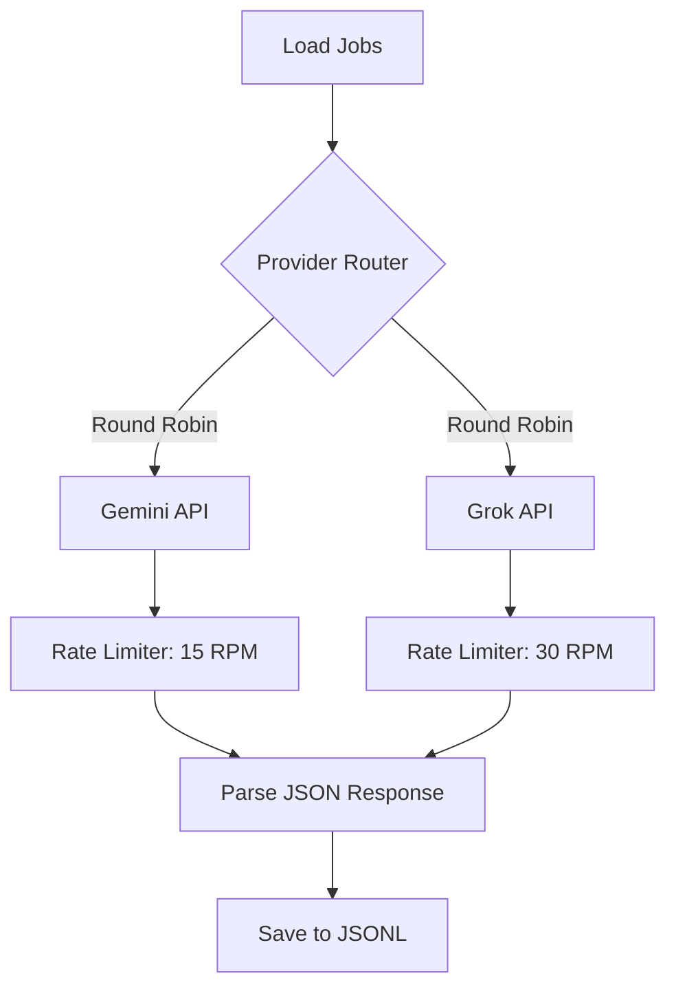

# AI Scoring Phase — Audit & Fix Implementation Plan

> **Status:** PLANNED — Awaiting user approval  
> **Scope:** AI Scoring audit ONLY — ❌ No regex, ❌ No scraping, ❌ No resume generation  
> **APIs:** Gemini Free Tier (15 RPM) + Grok Free Tier (30 RPM)  
> **Cost:** $0.00 (all free tier)

---

## Design Decisions (Locked via /grill-me)

| # | Decision | Choice |
|---|----------|--------|
| 1 | Jobs to score | ~73 that survived regex filtering (production path) |
| 2 | API strategy | BOTH Gemini + Grok in parallel rotation (45 RPM combined) |
| 3 | Cross-validation | Yes — every job scored by BOTH providers independently |
| 4 | Prompt strategy | Test existing `scoring_prompt.txt` first, then create v2 |
| 5 | Code modification | New `ai_engine_v2.py` in `scoring_audit/`, originals untouched |
| 6 | Quality definition | Score accuracy against agent-generated ground truth |
| 7 | Prompt rewrite | Yes — create `scoring_prompt_v2.txt` after audit |
| 8 | Agreement threshold | ±10 points between Gemini and Grok |
| 9 | Output directory | `scoring_audit/` at project root |
| 10 | Final integration | Yes — update `src/ai_engine.py` with multi-provider support |

---

## Phase 1: Create Synthetic Test JD Dataset (~300 JDs)

### Purpose
Before touching real jobs, we create a controlled synthetic dataset of **300 diverse JDs** designed to stress-test every edge case of the scoring system. Each JD is unique, realistic, and categorized so we **know exactly what the correct score should be** before the AI even sees it.

### Categories (15 categories × 20 JDs each = 300 JDs)

| # | Category | Expected Score | What It Tests |
|---|----------|---------------|---------------|
| **C01** | Perfect Java/Spring Match | 80–95 | Core Java, Spring Boot, REST APIs, 0-2 yrs, Pune/Mumbai |
| **C02** | Perfect QA/Automation Match | 80–95 | Selenium, JUnit, pytest, Postman, manual+auto, fresher |
| **C03** | Good .NET/C# Match | 60–75 | C#, ASP.NET, Azure, SQL, OOP — moderate match |
| **C04** | Good Full Stack Match | 65–80 | HTML/CSS/JS + Python/Node backend, general SWE |
| **C05** | MERN Stack Roles | 70–85 | React, Express, MongoDB, Node.js — NEW domain test |
| **C06** | AI/ML/LLM Roles | 65–80 | Python, TensorFlow, LLM, Agentic AI — NEW domain test |
| **C07** | Senior Roles That Look Junior | 0–20 | Title says "Engineer" but JD buries "7+ years required" |
| **C08** | Out-of-Scope Stack | 0–15 | PHP/Laravel, Ruby/Rails, iOS/Swift, Android/Kotlin |
| **C09** | Non-Technical Roles with Tech Keywords | 0–10 | HR Tech Recruiter, Sales Engineer, Marketing Analyst |
| **C10** | Ambiguous/Borderline JDs | 40–60 | Mixed stacks, partial matches, vague descriptions |
| **C11** | Internship-Specific | 75–90 | Explicitly says "intern/trainee", Python/Java/QA |
| **C12** | DevOps/Cloud-Heavy | 20–40 | Mostly AWS/Kubernetes/Terraform — candidate has basics only |
| **C13** | Data Engineering/Analytics | 25–45 | SQL heavy but also Spark/Hadoop/Airflow — partial match |
| **C14** | Extremely Sparse JDs | varies | 2-3 line descriptions — tests how AI handles minimal info |
| **C15** | Trick JDs (Misleading) | varies | Title says "Java Developer" but JD is actually for SAP ABAP |

### Synthetic JD Structure
Each JD will be a unique, realistic-looking job posting with:
```json
{
  "synthetic_id": "C01_001",
  "category": "C01_perfect_java_match",
  "title": "Junior Java Developer",
  "company": "TechCorp Solutions",
  "location": "Pune, Maharashtra",
  "description": "Full realistic JD text (200-800 words)...",
  "expected_score_range": [80, 95],
  "expected_is_testing_role": false,
  "difficulty": "easy|medium|hard",
  "trap_elements": ["None"],
  "notes": "Straightforward core Java match for fresher"
}
```

### Key Rules for Synthetic JDs
- **Every JD looks completely different** — different companies, writing styles, formatting, lengths
- **No two JDs in the same category are similar** — different tech stacks, different phrasing
- **Real-world writing styles** — some formal, some casual, some bullet-heavy, some paragraph-heavy
- **Indian job market realistic** — Indian companies, Indian locations, INR salaries where mentioned
- **Length variety** — ranges from 100 words (sparse) to 800 words (detailed)
- **Known ground truth** — we pre-assign expected score ranges per category

### Output File
`scoring_audit/synthetic_jds.json` — Array of 300 objects

---

## Phase 2: Build Scoring Audit Engine (`ai_engine_v2.py`)

### Architecture



### `scoring_audit/ai_engine_v2.py` — Multi-Provider Scoring Engine

**Gemini Integration:**
- API: Google Generative AI (via `google-generativeai` SDK or REST)
- Model: `gemini-2.0-flash` (free tier)
- Rate limit: 15 RPM → 1 request every 4.0 seconds
- Response format: JSON mode

**Grok Integration:**
- API: xAI Grok (via OpenAI-compatible SDK)
- Model: `grok-3-mini` or available free model
- Rate limit: 30 RPM → 1 request every 2.0 seconds
- Response format: JSON mode

**Rate Limiting Strategy:**
```
Combined throughput: 45 RPM
For 300 synthetic + 73 real × 2 providers each = 746 total API calls
At 45 RPM effective: ~17 minutes total scoring time
With safety margin (4.5s/req avg): ~56 minutes
```

### Retry & Error Handling
- 3 retries per call with exponential backoff
- JSON parse fallback (extract `{...}` from response)
- Per-call timeout: 60 seconds
- Failed calls logged with full error details

---

## Phase 3: Score Synthetic JDs (300 × 2 = 600 API calls)

### Process
1. Load all 300 synthetic JDs from `scoring_audit/synthetic_jds.json`
2. Score each with **Gemini** using existing `scoring_prompt.txt` → save to `synthetic_gemini_scores.jsonl`
3. Score each with **Grok** using existing `scoring_prompt.txt` → save to `synthetic_grok_scores.jsonl`
4. Rate-limited: Gemini at 1 req/4s, Grok at 1 req/2s, interleaved

### Estimated Time
- 600 calls at combined 45 RPM = ~13 minutes
- With safety margin and retries: ~20-25 minutes

### Output Per Job
```json
{
  "synthetic_id": "C01_001",
  "category": "C01_perfect_java_match",
  "title": "Junior Java Developer",
  "provider": "gemini",
  "model": "gemini-2.0-flash",
  "match_score": 82,
  "reason": "Strong Java Spring REST API match for fresher",
  "job_summary": "Junior backend role using Java Spring Boot",
  "missing_skills": ["Kafka", "CI/CD"],
  "extracted_requirements": "Java, Spring Boot, REST APIs, SQL, Git",
  "is_testing_role": false,
  "expected_score_range": [80, 95],
  "score_within_expected": true,
  "response_time_ms": 1250,
  "raw_response": "...",
  "scored_at": "2026-09-29T22:00:00Z"
}
```

---

## Phase 4: Score Real Production Jobs (~73 × 2 = 146 API calls)

### Process
1. Load the 73 jobs that survived regex filtering from the master raw dataset
2. Apply the same scoring pipeline: Gemini + Grok, same prompt
3. Save to `real_gemini_scores.jsonl` and `real_grok_scores.jsonl`

### Estimated Time
- 146 calls at 45 RPM = ~3-4 minutes

---

## Phase 5: Cross-Validation & Quality Audit

### 5A. Synthetic JD Accuracy Analysis
For each of the 300 synthetic JDs:
- Compare Gemini score vs. expected range → **in-range or out-of-range**
- Compare Grok score vs. expected range → **in-range or out-of-range**
- Compare Gemini vs. Grok → **agreement (±10) or disagreement**
- Check `missing_skills` — flag any skill the candidate actually has
- Check `is_testing_role` — verify against category

**Metrics computed:**
| Metric | Description |
|--------|-------------|
| `category_accuracy` | % of JDs in each category where score fell within expected range |
| `provider_agreement` | % of JDs where Gemini and Grok agree within ±10 |
| `missing_skills_accuracy` | % of missing_skills that are genuinely missing from resume |
| `is_testing_role_accuracy` | % of correct testing role classifications |
| `over_scoring_rate` | % of JDs scored higher than expected |
| `under_scoring_rate` | % of JDs scored lower than expected |

### 5B. Real Job Score Analysis
For each of the ~73 real jobs:
- Agent-generated ground truth: Is the AI score reasonable?
- Cross-provider comparison: Do Gemini and Grok agree?
- Flag anomalies: score=0 for relevant jobs, score=90 for borderline jobs

### 5C. Scoring Prompt Deficiency Report
Analyze patterns across ALL flagged issues:
- Which categories consistently score wrong?
- Which provider is more accurate?
- What prompt instructions cause the most problems?
- Are MERN/AI jobs being under-scored due to missing target domains?

### Output
- `scoring_audit/synthetic_analysis_report.md` — Full synthetic JD results
- `scoring_audit/real_jobs_analysis_report.md` — Real job scoring results
- `scoring_audit/cross_validation_report.md` — Provider comparison
- `scoring_audit/scoring_prompt_deficiencies.md` — Root cause analysis

---

## Phase 6: Create `scoring_prompt_v2.txt` & Re-Score

### Changes to Implement
Based on audit findings, create `scoring_audit/scoring_prompt_v2.txt`:

**Known issues to fix (from codebase analysis):**
1. **Missing target domains:** Add MERN Stack and AI/ML/LLM to target roles list
2. **Score calibration:** Current ranges may not transfer well to Gemini/Grok
3. **Missing skills accuracy:** Strengthen the cross-check instruction
4. **Provider-agnostic:** Remove DeepSeek-specific instructions

**Re-scoring:**
- Re-run ALL 300 synthetic + 73 real jobs with `scoring_prompt_v2.txt`
- Compare v1 vs. v2 accuracy metrics
- Generate `scoring_audit/v1_vs_v2_comparison.md`

### Estimated Time
- 746 more API calls at 45 RPM = ~17-20 minutes

---

## Phase 7: Production Integration

### Update `src/ai_engine.py` for Multi-Provider Support

**New config.yaml structure:**
```yaml
ai:
  provider: "gemini"        # gemini | grok | deepseek
  scoring_model: "gemini-2.0-flash"
  api_key: ""               # Provider-specific key
  temperature: 0.3
  
  # Provider-specific settings
  gemini:
    model: "gemini-2.0-flash"
    rpm_limit: 15
  grok:
    model: "grok-3-mini"
    base_url: "https://api.x.ai/v1"
    rpm_limit: 30
  deepseek:
    model: "deepseek-chat"
    base_url: "https://api.deepseek.com"
```

**Changes to `src/ai_engine.py`:**
- Add provider router: `_get_client()` reads `ai.provider` from config
- Add Gemini client (via `google-generativeai` SDK or OpenAI-compatible endpoint)
- Add Grok client (OpenAI-compatible with xAI base_url)
- Keep DeepSeek as fallback
- Add rate limiting per provider
- Replace `scoring_prompt.txt` with `scoring_prompt_v2.txt`

**Changes to `src/prompts/scoring_prompt.txt`:**
- Replace with proven `scoring_prompt_v2.txt` content
- Backup original as `scoring_prompt_v1_backup.txt`

---

## Directory Structure

```
scoring_audit/
├── synthetic_jds.json                    # 300 synthetic test JDs
├── ai_engine_v2.py                       # Multi-provider scoring engine
├── run_scoring_audit.py                  # Main audit runner script
├── scores/
│   ├── synthetic_gemini_scores.jsonl     # Gemini scores for synthetic JDs
│   ├── synthetic_grok_scores.jsonl       # Grok scores for synthetic JDs
│   ├── real_gemini_scores.jsonl          # Gemini scores for real jobs
│   ├── real_grok_scores.jsonl            # Grok scores for real jobs
│   ├── v2_synthetic_gemini_scores.jsonl  # V2 prompt re-scores
│   ├── v2_synthetic_grok_scores.jsonl
│   ├── v2_real_gemini_scores.jsonl
│   └── v2_real_grok_scores.jsonl
├── analysis/
│   ├── synthetic_analysis_report.md
│   ├── real_jobs_analysis_report.md
│   ├── cross_validation_report.md
│   ├── scoring_prompt_deficiencies.md
│   └── v1_vs_v2_comparison.md
└── scoring_prompt_v2.txt                 # Improved scoring prompt
```

---

## API Call Budget & Timeline

| Phase | What | API Calls | Estimated Time |
|-------|------|-----------|---------------|
| 3 | Synthetic JDs × 2 providers | 600 | ~20-25 min |
| 4 | Real jobs × 2 providers | 146 | ~3-4 min |
| 6 | Re-score with v2 prompt × 2 | 746 | ~17-20 min |
| **Total** | | **~1,492** | **~45-55 min** |

All calls use **free tier** APIs:
- Gemini: `gemini-2.0-flash` — 15 RPM free
- Grok: `grok-3-mini` — 30 RPM free
- **Total cost: $0.00**

---

## API Keys Required

| Provider | Env Variable | How to Get |
|----------|-------------|------------|
| Gemini | `GEMINI_API_KEY` | Already in `.env` (used by existing audit script) |
| Grok | `GROK_API_KEY` | https://console.x.ai → Free tier API key |

> [!IMPORTANT]
> You mentioned you'll revoke the DeepSeek API key. The scoring audit does NOT need DeepSeek at all. Only Gemini and Grok free tiers are used.

---

## Success Criteria

| Metric | Target |
|--------|--------|
| Synthetic category accuracy (v2 prompt) | ≥90% of scores within expected range |
| Cross-provider agreement | ≥80% within ±10 points |
| Missing skills accuracy | ≥85% genuinely missing from resume |
| is_testing_role accuracy | ≥95% correct classification |
| Real job scoring reasonableness | ≥90% scores judged reasonable by evaluation agents |
| V2 prompt improvement over V1 | Measurable increase in category accuracy |

---

## Estimated Total Timeline

| Step | Duration |
|------|----------|
| Create 300 synthetic JDs | ~15 min (agent-generated) |
| Build ai_engine_v2.py | ~10 min |
| Score synthetic JDs (Phase 3) | ~20-25 min |
| Score real jobs (Phase 4) | ~3-4 min |
| Cross-validation & audit (Phase 5) | ~10-15 min |
| Create scoring_prompt_v2 & re-score (Phase 6) | ~20-25 min |
| Production integration (Phase 7) | ~15 min |
| **Total** | **~100-110 min** |
